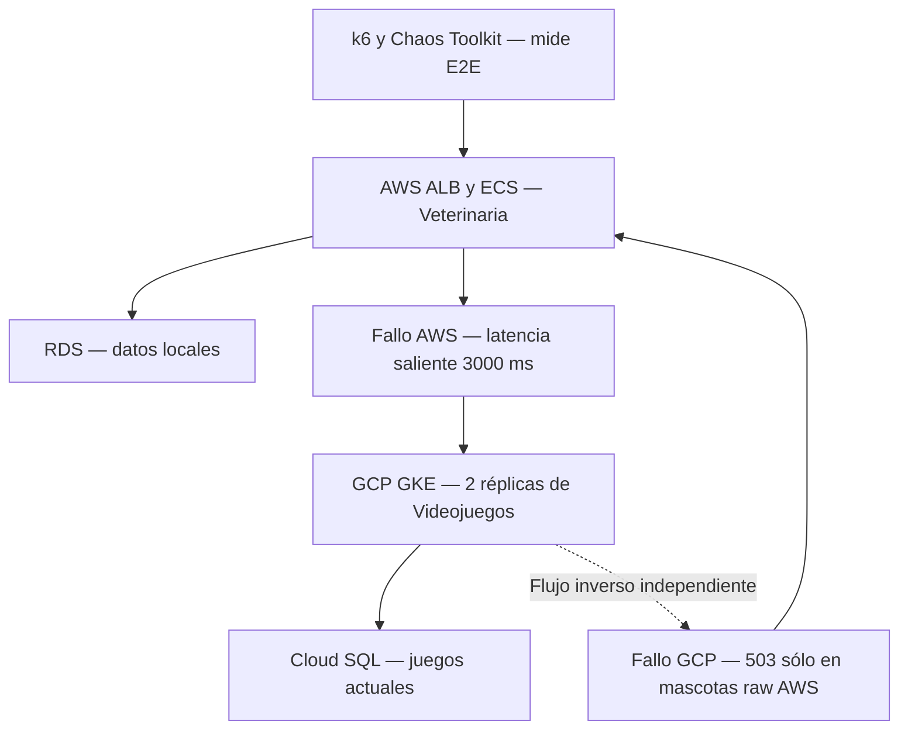

# Videojuegos V4 Ingeniería del Caos multicloud

Entrega para dos integrantes. GCP aloja esta API; la otra nube aloja la API compañera. Versión 4.0.0. Empezar por [la guía completa de despliegue](docs/GUIA-DESPLIEGUE.md), que también cubre la otra nube y el orden de integración.

## Flujo y contratos

AWS coordina el flujo principal `GET /owners`, `/pets` o `/appointments`, también por ID numérico, hacia `GCP /juegos/raw`. GCP ofrece el flujo inverso desde juegos, jugadores y compras hacia `AWS /pets/raw`. Cada respuesta tiene `data` local y un único `juego` o `mascota` aleatorio, leído en esa petición. Sin caché. Un ID inexistente conserva 404. POST/PATCH/DELETE no cambian. Las rutas raw evitan recursión y no hacen composición. Los alias `/api/v2` y `/api/v3` de GCP se conservan como rutas, pero sus GET adoptan el contrato V4; los consumidores deben actualizarse.



Las flechas de ida y vuelta representan dos peticiones independientes: una llamada raw termina en esa nube y no vuelve a invocar a su compañera. Frontera del radio de impacto: solicitudes sintéticas GET que portan token y vencimiento; no toda la infraestructura ni todas las peticiones. k6 mide fuera de las APIs, en el cliente que ejecuta la prueba. Cada API registra spans JSON con traceId, parentSpanId, duración y resultado en CloudWatch o logs de GKE. RDS y Cloud SQL quedan fuera de la inyección.

## Matriz de responsabilidades

| Integrante | Fallo propio | Métrica objetivo | Protección aplicada |
|---|---|---|---|
| Veterinaria AWS | 3000 ms en llamada saliente a juegos GCP | p95 extremo a extremo <1500 ms | Timeout de 800 ms + respuesta parcial sin caché |
| Videojuegos GCP | 503 sostenido de mascotas AWS para solicitudes de prueba | Error del servicio local <=1% | Timeout de 800 ms + respuesta parcial sin caché |

La ubicación física del 503 es el endpoint de mascotas AWS, pero el experimento y la hipótesis pertenecen a GCP, que consume esa dependencia. Ronda 0 usa límite de seguridad de 6 s y propaga fallo como 502. Ronda 1 usa 800 ms y conserva datos locales. No se afirma que una respuesta parcial cumpla el flujo completo: se mide `integration_complete` por separado. Las dos métricas son propuestas acordables antes de ejecutar, no valores ya medidos en nube.

## Qué se conserva y qué se retira

AWS conserva aplicación NestJS/TypeORM, entidades, RDS, VPC, ALB, ECS, secretos, logs y CloudFront. GCP conserva FastAPI/SQLAlchemy, las tres entidades, Cloud SQL y Artifact Registry; el despliegue activo V4 usa GKE Autopilot con dos réplicas, probes HTTP y límites. Se retira el tráfico ponderado canary y sus workflows; se mantiene el historial Git. No se reconstruyen cola, caché ni almacenamiento de objetos de V2. S3/GCS sirven únicamente al estado Terraform. El módulo Cloud Run se conserva como opción de transición y está deshabilitado por defecto. La guía explica cómo reutilizar estado y esquemas existentes.

## Código del experimento y pruebas

- `chaos/`: experimento declarativo Chaos Toolkit con hipótesis, radio, tiempo, abortos y rollback.
- `chaos_actions.py`: ejecuta mediciones, verifica control independiente y gate.
- `load/profile.js`: 15 s de subida a 5 VU, 60 s constantes y 15 s de bajada; mismo perfil en todas las rondas.
- `scripts/chaos-gate.sh`: mide estado estable, ronda 0, ronda 1 y recuperación.
- `scripts/report-v4.py`: comparación, tablero HTML e informe preliminar a partir de datos reales.
- `observability/v4`: Grafana, Prometheus y Pushgateway opcionales, sin depender de Grafana Cloud.
- `tests-v4`: pruebas de integración local y del comportamiento de fallos.

```bash
pip install -r requirements.txt pytest && PYTHONPATH=. pytest tests-v4 -q
```

Los tests heredados de GCP en `tests/` se retiraron del paquete V4 porque esperaban el contrato anterior y una base PostgreSQL externa. La prueba V4 usa SQLite aislado y servidor HTTP de dependencia; no reemplaza la verificación PostgreSQL/GKE desplegada. En AWS la prueba usa Fastify y el middleware real con handlers locales de fixture; el despliegue debe comprobar además NestJS, TypeORM y RDS.

## Evidencia y límites

Ver [matriz de rúbrica](docs/MATRIZ-RUBRICA.md), [sustentación](docs/SUSTENTACION.md) y [validación](docs/VALIDACION.md). No hay evidencias reales de sus cuentas ni un estado estable medido en nube precargados. La ejecución genera los archivos dentro de `evidence/`; conservar la ejecución final en Git con `git add -f` y completar el diagnóstico. El informe final no debe superar seis páginas.

La inyección requiere ventana acordada y datos sintéticos en infraestructura propia. Se usa token >=32 caracteres, activación explícita en entorno y TTL de 15 s por petición del generador; no se guardan secretos en código. La reversión consiste en dejar de emitir cabeceras, esperar el límite de las peticiones en curso y verificar un GET completo. La guía incluye apagado y destrucción.

## Versionado y fuentes

Todos los commits del trabajo deben empezar con GitMoji. Publicar tag SemVer `v4.0.0` y release usando el workflow incluido después de registrar evidencia real. Herramienta de apoyo: ChatGPT; propuso timeout y degradación sin caché. Se descartaron caché y reintentos para respetar realtime y no amplificar el fallo.

Fuentes técnicas: [Chaos Toolkit](https://chaostoolkit.org/reference/api/experiment/), [GKE y Cloud SQL](https://docs.cloud.google.com/sql/docs/postgres/connect-kubernetes-engine), [k6 thresholds](https://grafana.com/docs/k6/latest/using-k6/thresholds/).
