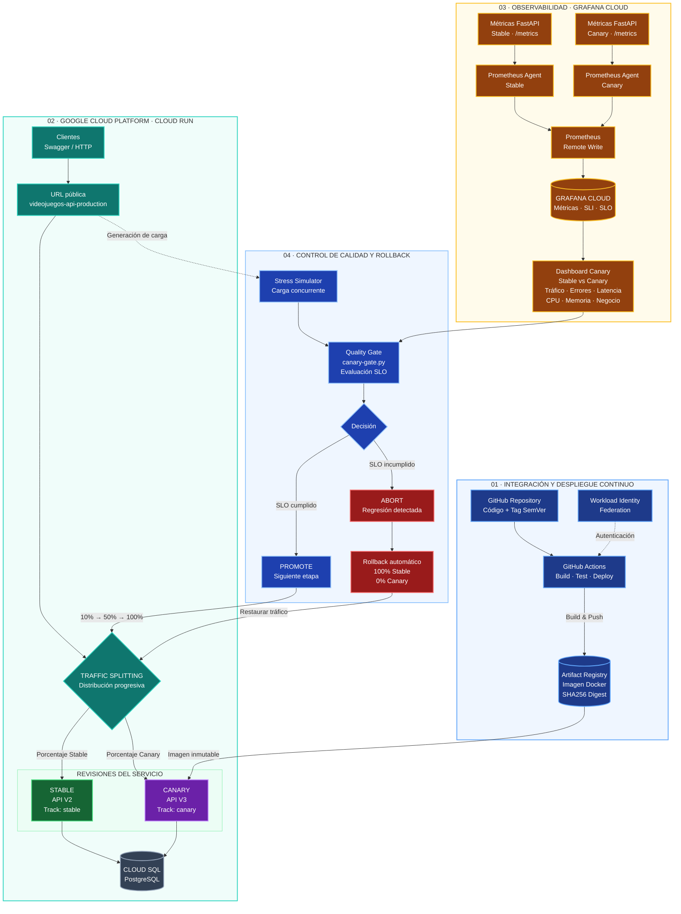

# Videojuegos API — Canary Deployment

API RESTful desarrollada con Python y FastAPI para la gestión de una tienda de videojuegos, jugadores y compras, con persistencia en PostgreSQL.

Este repositorio implementa una estrategia **Canary Deployment** utilizando Google Cloud Run, Cloud SQL PostgreSQL, Artifact Registry, GitHub Actions y Grafana Cloud.

| Elemento | Versión / configuración |
|---|---|
| API estable | V2 — Stable |
| API candidata | V3 — Canary |
| Release Canary | `v4.1.2` |
| Proveedor cloud | Google Cloud Platform |
| Servicio | `videojuegos-api-production` |
| Región | `us-central1` |
| Base de datos | Cloud SQL PostgreSQL |
| Observabilidad | Grafana Cloud / Prometheus |
| CI/CD | GitHub Actions |

---

# 1. Descripción general

El proyecto reutiliza el microservicio de videojuegos desarrollado durante el semestre y permite mantener dos revisiones de la API simultáneamente en producción:

- **Stable (API V2):** versión estable que mantiene el contrato anterior.
- **Canary (API V3):** nueva versión que incorpora una funcionalidad observable de disponibilidad de inventario.

Ambas versiones pueden atender peticiones simultáneamente y utilizan la misma base de datos PostgreSQL, manteniendo la compatibilidad hacia atrás.

La distribución de tráfico se administra mediante Google Cloud Run y se modifica progresivamente desde GitHub Actions.

Cada respuesta HTTP incorpora dos cabeceras que permiten identificar qué versión y revisión atendió la petición:

- `X-App-Version`
- `X-App-Track`

---

# 2. Tecnologías utilizadas

| Componente | Tecnología |
|---|---|
| Lenguaje | Python 3.11 |
| Framework | FastAPI |
| Validación | Pydantic |
| ORM | SQLAlchemy |
| Base de datos | PostgreSQL |
| Infraestructura | Google Cloud Platform |
| Plataforma de despliegue | Google Cloud Run |
| Base de datos administrada | Cloud SQL |
| Registro de imágenes | Artifact Registry |
| Infraestructura como código | Terraform |
| Integración y despliegue | GitHub Actions |
| Métricas | Prometheus |
| Observabilidad | Grafana Cloud |
| Dashboard | Grafana |
| Control de versiones | Git, GitMoji y SemVer |
| Contenedores | Docker |

---

# 3. Entidades del microservicio

El microservicio administra las siguientes entidades:

**Jugador**
- id
- nombre
- correo
- fecha_registro

**Juego**
- id
- nombre
- genero
- plataforma
- precio
- stock

**Compra**
- id
- fecha
- cantidad
- total
- jugador_id
- juego_id

Relaciones:

- Jugador 1:N Compra.
- Juego 1:N Compra.

---

# 4. Versionamiento de la API

Se mantiene la convivencia de las dos versiones mediante rutas explícitas.

| Versión | Track | Función |
|---|---|---|
| API V2 | Stable | Contrato estable anterior |
| API V3 | Canary | Contrato anterior compatible y nueva funcionalidad |

## Endpoints V2 — Stable

| Método | Endpoint | Descripción |
|---|---|---|
| POST | `/api/v2/juegos/` | Crear videojuego |
| GET | `/api/v2/juegos/` | Listar videojuegos |
| GET | `/api/v2/juegos/{id}` | Consultar videojuego |
| PATCH | `/api/v2/juegos/{id}` | Actualizar videojuego |
| DELETE | `/api/v2/juegos/{id}` | Eliminar videojuego |
| GET | `/api/v2/jugadores/` | Listar jugadores |
| POST | `/api/v2/jugadores/` | Crear jugador |
| GET | `/api/v2/compras/` | Listar compras |
| POST | `/api/v2/compras/` | Registrar compra |

## Endpoints V3 — Canary

La versión V3 conserva las operaciones anteriores y añade:

| Método | Endpoint | Descripción |
|---|---|---|
| GET | `/api/v3/juegos/` | Listar videojuegos |
| GET | `/api/v3/jugadores/` | Listar jugadores |
| GET | `/api/v3/compras/` | Listar compras |
| GET | `/api/v3/juegos/{juego_id}/disponibilidad` | Consultar disponibilidad del inventario |

## Nueva funcionalidad Canary

La nueva funcionalidad se encuentra implementada en:

`app/routers/v3.py`

Endpoint:

```http
GET /api/v3/juegos/{juego_id}/disponibilidad
```

Permite consultar el estado del inventario de un videojuego.

La respuesta incluye:

```json
{
  "juego_id": 1,
  "nombre": "Juego de prueba Canary",
  "stock": 10,
  "disponible": true,
  "estado_inventario": "disponible",
  "mensaje": "Hay unidades disponibles"
}
```

La funcionalidad calcula la disponibilidad utilizando la columna `stock` existente en PostgreSQL.

---

# 5. Arquitectura del despliegue Canary

## Proveedor de nube

El despliegue utiliza Google Cloud Platform con los siguientes servicios:

- Google Cloud Run: ejecución y distribución del tráfico entre revisiones.
- Cloud SQL: persistencia PostgreSQL.
- Artifact Registry: almacenamiento de imágenes Docker.
- GitHub Actions: automatización del despliegue y promoción.
- Grafana Cloud: almacenamiento y consulta de métricas Prometheus.

**Proyecto GCP:** `videojuegos-api-2026-ihoyos`

**Región:** `us-central1`

**Servicio Cloud Run:** `videojuegos-api-production`

## Diagrama de arquitectura





Las dos revisiones utilizan la misma base de datos de producción.

El tráfico se distribuye mediante las revisiones de Cloud Run, no mediante reglas independientes por ruta HTTP.

## URLs del despliegue

**API pública:**

https://videojuegos-api-production-xyuxyg7wlq-uc.a.run.app

**Swagger público:**

https://videojuegos-api-production-xyuxyg7wlq-uc.a.run.app/docs

**Swagger Stable:**

https://stable---videojuegos-api-production-xyuxyg7wlq-uc.a.run.app/docs

**Swagger Canary:**

https://canary---videojuegos-api-production-xyuxyg7wlq-uc.a.run.app/docs

Las URL etiquetadas permiten realizar pruebas directamente sobre cada revisión, independientemente del porcentaje de tráfico público asignado.

---

# 6. División progresiva del tráfico

El mecanismo de traffic splitting se configura mediante Google Cloud Run.

El workflow:

`.github/workflows/rollout-canary.yml`

Ejecuta las etapas de promoción y modifica el tráfico mediante:

```bash
gcloud run services update-traffic
```

## Plan de etapas

La configuración predeterminada utiliza:

| Etapa | Stable | Canary | Tiempo de horneado |
|---|---:|---:|---|
| 0 | 100% | 0% | Pruebas internas |
| 1 | 90% | 10% | 120 segundos |
| 2 | 50% | 50% | 120 segundos |
| 3 | 0% | 100% | 120 segundos |

El workflow permite parametrizar los siguientes planes:

- 10% → 50% → 100%.
- 5% → 25% → 100%.
- 10% → 25% → 100%.

El tiempo de horneado puede configurarse en 120, 180 o 240 segundos por etapa.

### Etapa 0 — 0% público

Canary permanece desplegado y disponible mediante su URL etiquetada.

Se ejecutan pruebas de humo y comprobación de identidad mediante las cabeceras HTTP.

### Etapa 1 — Primera exposición

Se asigna el porcentaje inicial de tráfico a Canary.

Se ejecutan pruebas concurrentes y se evalúan las métricas contra los umbrales SLO.

### Etapa 2 — Incremento de tráfico

Se aumenta la exposición de Canary únicamente cuando la etapa anterior supera las verificaciones.

### Etapa 3 — Promoción completa

Se asigna el 100% del tráfico público a Canary.

La revisión Stable permanece disponible para realizar rollback.

---

# 7. Artefacto inmutable y versionamiento

La imagen Docker se construye y publica en Google Artifact Registry.

Repositorio:

```text
us-central1-docker.pkg.dev/videojuegos-api-2026-ihoyos/videojuegos-api/api
```

El proceso de despliegue:

1. Obtiene el código desde un tag SemVer.
2. Construye la imagen Docker.
3. Publica la imagen en Artifact Registry.
4. Obtiene su digest SHA256.
5. Despliega la revisión Canary utilizando la referencia inmutable del digest.

El despliegue utiliza una referencia de este tipo:

```text
IMAGE@sha256:<digest>
```

De esta manera, la revisión desplegada queda asociada a una imagen concreta.

## GitMoji y SemVer

El proyecto utiliza:

- GitMoji para identificar el propósito de los commits.
- Semantic Versioning para identificar las versiones.
- Tags Git para generar releases.

Release Canary utilizado:

```text
v4.1.2
```

Ejemplo de convención de commit:

```bash
git commit -m ":rocket: implement canary deployment"
```

---

# 8. Compatibilidad de datos — Expand/Contract

La nueva funcionalidad V3 mantiene la compatibilidad hacia atrás con la estructura de datos utilizada por V2.

No se realizan migraciones destructivas.

La funcionalidad de disponibilidad consulta la columna `stock` que ya existe en la tabla de videojuegos.

## Expand

Se incorpora la nueva ruta:

```text
/api/v3/juegos/{juego_id}/disponibilidad
```

Se calcula el estado de disponibilidad mediante los datos existentes.

No se agregan columnas obligatorias ni se modifican las relaciones actuales.

## Convivencia

Las revisiones Stable y Canary utilizan Cloud SQL PostgreSQL y el esquema de producción compartido.

V2 conserva su contrato y V3 incorpora la nueva funcionalidad.

## Contract

En esta entrega no se ejecutan eliminaciones de columnas, modificaciones destructivas ni cambios que impidan el rollback.

La estructura anterior permanece disponible para que Stable pueda seguir funcionando.

El proyecto no incorpora colas ni una capa de caché en esta implementación.

Por tanto, no se requieren modificaciones de esos componentes.

---

# 9. Observabilidad y métricas SLI/SLO

La observabilidad utiliza Prometheus y Grafana Cloud.

La aplicación expone sus métricas mediante:

```http
GET /metrics
```

El archivo encargado de registrar las métricas personalizadas es:

`app/observability/metrics.py`

El agente Prometheus se configura mediante:

- `observability/agent/start.sh`
- `observability/agent/prometheus-agent.yml.tmpl`

El agente consulta las métricas de la instancia y las envía a Grafana Cloud mediante Remote Write.

## Identificación de las métricas

Las métricas se separan mediante las etiquetas:

- `service`
- `track`
- `app_version`
- `revision`

Esto permite comparar Stable y Canary independientemente.

## Señales doradas y métricas

| Señal | Métrica |
|---|---|
| Tráfico | `http_requests_total` |
| Errores HTTP | `http_requests_total` con etiquetas de estado |
| Latencia | `http_request_duration_highr_seconds_bucket` |
| CPU | `process_cpu_seconds_total` |
| Memoria | `process_resident_memory_bytes` |
| Identidad de la aplicación | `videojuegos_app_info` |
| Negocio | `videojuegos_compras_creadas_total` |
| Ventas | `videojuegos_ventas_monto_total` |

Se utilizan percentiles p50, p95 y p99 para evaluar la latencia.

Las métricas de CPU y memoria se relacionan con los límites configurados para el contenedor.

La métrica de negocio registra las compras confirmadas correctamente.

## Dashboard de Grafana

Dashboard:

**Videojuegos API · Canary: stable (v2) vs canary (v3)**

https://tanreed352.grafana.net/d/videojuegos-canary/fa18ce5

El tablero permite visualizar:

- Peticiones por segundo de Stable y Canary.
- Errores HTTP 4xx y 5xx.
- Latencias p50, p95 y p99.
- Uso de CPU.
- Uso de memoria.
- Compras creadas.
- Revisiones y versiones en ejecución.
- Instancias activas por track.

Las métricas se presentan separadas por `stable` y `canary` para facilitar la comparación durante las etapas de promoción y los eventos de rollback.

---

# 10. Umbrales de decisión SLI/SLO

Los umbrales están definidos y versionados en:

`observability/slo.yaml`

Este archivo es la fuente de configuración de la puerta de análisis.

La decisión tiene tres posibles resultados:

- PROMOTE: todas las métricas cumplen los umbrales de promoción.
- PAUSE: alguna métrica supera el umbral de promoción, pero no el de aborto. Se espera y se vuelve a evaluar.
- ABORT: alguna métrica supera el umbral de aborto. Se ejecuta rollback.

## Umbrales configurados

| Métrica | Umbral de promoción | Umbral de aborto |
|---|---:|---:|
| Errores HTTP 5xx | 0,5% | 1% |
| Errores HTTP 4xx | 2% | 5% |
| Latencia p95 | 400 ms | 500 ms |
| Regresión p95 frente a Stable | 20% | 40% |
| CPU | 70% | 80% |
| Memoria | 75% | 85% |

La comparación de latencia ignora diferencias absolutas inferiores a 50 ms para reducir decisiones causadas por pequeñas variaciones de medición.

## Tamaño de muestra

La puerta de análisis tiene configurados:

- Mínimo de 200 peticiones Canary.
- Mínimo de 100 peticiones Stable para la comparación de baseline.

Si la muestra es insuficiente, la puerta espera y vuelve a evaluar.

La configuración permite hasta tres reintentos, separados por 60 segundos.

También se espera 45 segundos para permitir que Grafana reciba las últimas muestras antes de realizar la evaluación.

---

# 11. Comparación Canary frente a Stable

El proyecto incorpora dos mecanismos de comprobación.

## Simulador de estrés por etapas

Archivo:

`scripts/stress-simulator.py`

Genera tráfico real hacia la URL pública del servicio mediante fases de concurrencia creciente.

Utiliza rutas que existen en ambas revisiones:

```text
/api/v2/juegos/
/api/v2/jugadores/
```

Comprueba:

- Distribución real del tráfico mediante `X-App-Track`.
- Porcentaje observado frente al porcentaje esperado.
- Respuestas HTTP 2xx, 4xx y 5xx.
- Latencias p50, p95 y p99.
- Identidad del track que procesa cada petición.

También prueba la nueva funcionalidad V3 directamente mediante la URL etiquetada Canary.

## Comparación de baseline

Archivo:

`scripts/compare-baseline.py`

Permite ejecutar una prueba concurrente independiente entre Stable y Canary.

La configuración predeterminada utiliza:

- 1.000 peticiones por revisión.
- Concurrencia de 20 peticiones.
- Comparación de errores y latencias.
- Comparación de p95.
- Lectura de utilización de CPU y memoria mediante Cloud Monitoring.

Genera un reporte JSON dentro de `reports/`.

---

# 12. Inyección de fallos y rollback

La inyección de fallos está implementada en:

`app/observability/fault_injection.py`

Solo afecta a la revisión Canary y requiere que la inyección haya sido habilitada durante su despliegue.

Admite dos escenarios:

| Fallo | Comportamiento |
|---|---|
| `error` | Simula respuestas HTTP 500 |
| `latency` | Incrementa la latencia de las peticiones |

La activación se realiza mediante las cabeceras:

```http
X-Canary-Fault: error
X-Canary-Fault-Token: <token>
```

El token se valida antes de permitir la inyección.

## Quality Gate

Archivo:

`scripts/canary-gate.py`

Consulta Prometheus en Grafana Cloud y compara las señales de Canary con la línea base Stable.

Si se supera un umbral de aborto, o se agotan los reintentos de pausa, la decisión es ABORT.

## Rollback automático

El proceso está implementado en:

`scripts/canary-rollout.sh`

Cuando una etapa falla:

1. Se interrumpe la promoción.
2. Se devuelve el 100% del tráfico a Stable.
3. Canary permanece desplegado y etiquetado.
4. Se verifica que la URL pública responda con el track Stable.
5. Se genera un reporte del resultado.

## Rollback manual

Workflow:

`.github/workflows/rollback-canary.yml`

Permite restaurar manualmente el 100% del tráfico hacia Stable.

---

# 13. Workflows de GitHub Actions

El repositorio contiene los siguientes workflows:

| Archivo | Función |
|---|---|
| `terraform.yml` | Despliegue de infraestructura y API estable |
| `deploy-canary.yml` | Construcción y despliegue Canary en etapa 0 |
| `rollout-canary.yml` | Promoción progresiva con simulador y quality gate |
| `rollback-canary.yml` | Rollback manual a Stable |

## Despliegue Canary

Workflow:

**Canary - Build y despliegue (etapa 0, 0% público)**

Se ejecuta manualmente desde un tag SemVer.

Construye la imagen inmutable, despliega una nueva revisión Canary y mantiene el 100% del tráfico público en Stable.

Realiza una prueba de humo sobre la URL etiquetada Canary y verifica las cabeceras de versión y track.

## Promoción progresiva

Workflow:

**Canary - Promoción progresiva con simulador de estrés**

Se ejecuta manualmente desde el tag SemVer correspondiente a la versión desplegada.

Permite configurar:

- Tiempo de horneado.
- Porcentajes de promoción.
- Número de peticiones de estrés.
- Tipo de fallo para las pruebas de rollback.
- Etapa desde la que se activa el fallo.

Las etapas se ejecutan en orden y cada una debe superar el simulador y la puerta de análisis de Grafana.

Al finalizar, GitHub Actions adjunta el artefacto:

```text
canary-rollout-report.zip
```

Este contiene los reportes JSON generados durante la promoción.

---

# 14. Configuración de GitHub Actions

Las variables del repositorio utilizadas para autenticación son:

| Variable | Uso |
|---|---|
| `GCP_WORKLOAD_IDENTITY_PROVIDER` | Autenticación federada con Google Cloud |
| `GCP_SERVICE_ACCOUNT` | Cuenta de servicio de despliegue |

Secretos utilizados:

| Secreto | Uso |
|---|---|
| `GRAFANA_METRICS_WRITE_TOKEN` | Envío de métricas a Grafana Cloud |
| `GRAFANA_METRICS_READ_TOKEN` | Consulta de métricas por el quality gate |
| `GRAFANA_API_TOKEN` | Anotaciones de decisiones en Grafana |
| `CANARY_FAULT_TOKEN` | Autorización de inyección de fallos |
| `TF_VAR_DATABASE_PASSWORD` | Contraseña de la base de datos para Terraform |

Los valores de los secretos se almacenan en GitHub Actions y no deben incluirse en el repositorio.

---

# 15. Estructura del proyecto

```text
videojuegos-api/
│
├── app/
│   ├── main.py
│   ├── database.py
│   ├── models.py
│   ├── schemas.py
│   ├── crud.py
│   │
│   ├── routers/
│   │   ├── jugadores.py
│   │   ├── juegos.py
│   │   ├── compras.py
│   │   └── v3.py
│   │
│   └── observability/
│       ├── __init__.py
│       ├── metrics.py
│       └── fault_injection.py
│
├── observability/
│   ├── agent/
│   │   ├── start.sh
│   │   └── prometheus-agent.yml.tmpl
│   ├── grafana-dashboard.json
│   ├── metrics.py
│   └── slo.yaml
│
├── scripts/
│   ├── canary-gate.py
│   ├── canary-rollout.sh
│   ├── stress-simulator.py
│   ├── compare-baseline.py
│   └── rollback-canary.sh
│
├── terraform/
│   ├── main.tf
│   ├── providers.tf
│   ├── variables.tf
│   ├── outputs.tf
│   ├── cloud_run.tf
│   ├── cloud_sql.tf
│   ├── artifact_registry.tf
│   ├── iam.tf
│   └── modules/
│
├── .github/
│   └── workflows/
│       ├── terraform.yml
│       ├── deploy-canary.yml
│       ├── rollout-canary.yml
│       └── rollback-canary.yml
│
├── tests/
├── Dockerfile
├── requirements.txt
└── README.md
```

---

# 16. Ejecución local

## Requisitos

- Python 3.11 o superior.
- PostgreSQL.
- pip.

## Instalación

```bash
git clone https://github.com/ihoyos57/videojuegos-api.git

cd videojuegos-api

python -m venv venv
```

En Windows PowerShell:

```powershell
.\venv\Scripts\Activate.ps1
```

Instalar dependencias:

```bash
pip install -r requirements.txt
```

Configurar las variables de conexión a PostgreSQL mediante `.env` o el entorno de ejecución.

Iniciar la API:

```bash
uvicorn app.main:app --reload
```

Documentación Swagger local:

```text
http://127.0.0.1:8000/docs
```

## Pruebas

```bash
pip install pytest pytest-cov
```

Ejecutar pruebas:

```bash
pytest tests/ -v
```

---

# 17. Referencias del despliegue

**Repositorio GitHub**

https://github.com/ihoyos57/videojuegos-api

**GitHub Actions**

https://github.com/ihoyos57/videojuegos-api/actions

**API pública**

https://videojuegos-api-production-xyuxyg7wlq-uc.a.run.app

**Dashboard Grafana**

https://tanreed352.grafana.net/d/videojuegos-canary/fa18ce5

---

# 18. Release

El release Canary de esta entrega utiliza versionamiento semántico:

```text
v4.1.2
```

El tag se encuentra publicado en el repositorio GitHub y sirve como referencia para ejecutar los workflows de despliegue y promoción.

La revisión Stable permanece disponible para mantener la compatibilidad y permitir el rollback sin migraciones destructivas.

